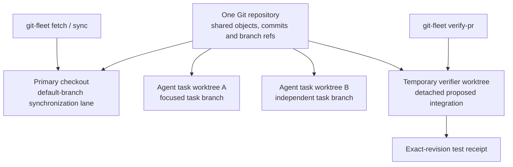
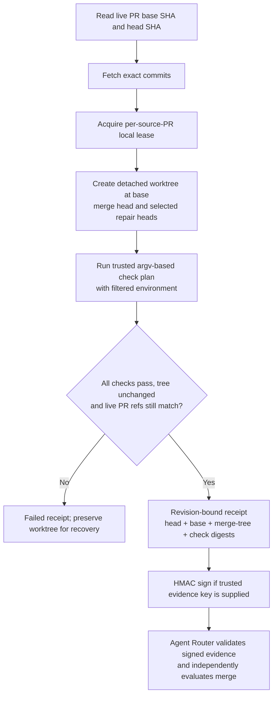
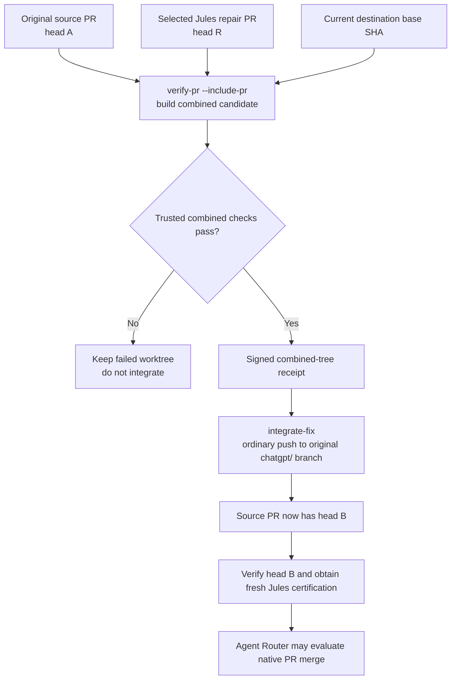

# git-fleet

Policy-driven synchronization and reconciliation for a fleet of local Git repositories.

`git-fleet` grew out of workstation automation for keeping Git checkouts aligned
without throwing away local work. The reusable engine is independent of the
scheduler, GitHub account, dotfiles manager, and machine layout.

## Worktree architecture

Git Fleet is a **local Git reconciliation and verification engine**, not the hosted Jules router or a deployment service. It is designed for one engineer managing multiple coding agents and local checkouts, while preserving explicit boundaries between sync, task edits, verification and merge authority.



These worktrees share Git history but keep their checked-out files and indexes separate. An agent can change its own task worktree without forcing the primary checkout to switch branches. Ordinary fleet discovery ignores linked task worktrees unless explicitly registered or targeted; active leases protect in-use checkouts. Git Fleet's temporary verifier worktree is **not** a security sandbox: untrusted PR code needs a disposable, credential-isolated executor.

| Lane | Responsibility | Not responsible for |
| --- | --- | --- |
| Primary checkout | Policy-driven fetch, alignment and reconciliation | Hosting concurrent agent edits |
| Task worktree | Agent-owned feature branch and PR preparation | Authorizing a protected-branch merge |
| Temporary verifier worktree | Build the exact integration candidate and run trusted checks | Protecting secrets by filesystem separation |
| [GitHub Agent Router](https://github.com/johnyoonh/github-agent-router) | Independent Jules certification and native merge evaluation | Executing local Fleet checks or deploying production |

## Commands

```sh
git-fleet status
git-fleet fetch
git-fleet sync --dry-run
git-fleet sync --only owner/repository
git-fleet policy show
git-fleet verify-pr --repo /path/to/repo --pr 123 --checks /trusted/checks.json --output /tmp/receipt.json --trust-code
```

Configuration defaults to `${XDG_CONFIG_HOME:-~/.config}/git-fleet`; runtime state
uses `${XDG_STATE_HOME:-~/.local/state}/git-fleet`.

## Publication is not bypass authorization

`publish` defaults to `false` for **every** automation profile. An explicit
`publish=true` still cannot publish directly to a github.com default branch or
any protected branch. Unknown protection/access state defers publication rather
than trying the write with elevated credentials. Local/non-GitHub transports
retain the existing opt-in, non-force publication behavior; enterprise-host
protection discovery is not inferred from github.com policy.

Default-branch work must go through a task branch and PR. Neither successful
reconciliation nor an admin token nor a passing local test is merge authority.
`github-agent-router` owns merge evaluation and the native PR merge operation.

## Exact-tree verification lifecycle

The **head SHA** is the source PR branch's latest commit, the **base SHA** is the destination branch's latest commit, and the **merge-tree SHA** is the Git tree object for the candidate created from them. None identifies a particular machine. Testing the PR head by itself is not the same as testing what would enter the base branch.



`verify-pr` fetches current GitHub revisions, combines them in a temporary worktree, records command exit codes, timeouts and log digests, then rechecks the PR revisions. Unexpected tracked-file changes, conflicts, stale revisions, missing checks or timeouts invalidate the pass. It signs the receipt **only** when the executor supplies `GIT_FLEET_EVIDENCE_KEY`. An unsigned or failed receipt is not merge authorization; an HMAC signature authenticates the executor's record but does not prove the check plan is sufficient.

Example (explicit code-execution trust is required):

```sh
git-fleet verify-pr --repo /repo --pr 12 \
  --checks /trusted/checks.json \
  --output /evidence/pr12.json --trust-code
```

Keep the check plan and signing key outside PR-controlled content. Ordinary CI, independent Jules review, rulesets and human approvals are separate gates. See [the verification contract](docs/VERIFICATION.md).

## Isolated verification and repair lineage

`verify-pr` leases one source PR, constructs its actual base-plus-head merge in a
dedicated worktree, runs an explicit trusted argv-based check plan, and emits a
revision-bound receipt. `--include-pr` adds explicitly selected repair PR heads to
the tested candidate. Failure, tracked-file mutation, conflicts, timeouts, or
head/base movement invalidate the receipt. Existing local work is preserved.

A worktree is **not a security sandbox**. `--trust-code` is required; run untrusted
code on disposable, credential-isolated workers. Test subprocesses receive an
allowlisted environment and temporary HOME, not provider tokens. Receipts are
HMAC-signed when `GIT_FLEET_EVIDENCE_KEY` is supplied by a trusted executor.
Unsigned receipts are informational, never merge approval.

`integrate-fix` can then integrate that exact tested repair tree into the original
`chatgpt/` PR branch using an ordinary push. It rejects stale/unsigned evidence,
protected targets, and changed trees. The new source head must be reverified and
recertified; a Jules-authored repair is not inherently safe.

Read [verification, repair integration and deployment boundaries](docs/VERIFICATION.md).

## Original-PR repair lineage

A Jules repair PR is a **candidate**, not permission to merge the repair directly or to skip review. Fleet tests the combination and can publish the exact verified result only back to the original `chatgpt/` source branch.



`integrate-fix` rejects changed source or repair heads, missing/expired signatures, nonmatching trees, and protected publication targets. It compares the constructed integration tree with the tested receipt before pushing. Because integration creates a **new source head**, old Jules certification is stale even if the effective file tree happens to be equivalent. It never pushes directly to the default branch. See [repair commands and lineage](docs/VERIFICATION.md).

## Reconciliation safety

The engine does not use force-push or hard-reset as normal recovery mechanisms.
It creates recovery refs before divergent-history rebases, snapshots dirty work
when policy permits it, and honors active leases. Automatic root discovery ignores
linked worktrees unless explicitly registered or targeted. Start with a small
registry and `git-fleet sync --dry-run` before unattended reconciliation.

## Availability, velocity and production boundaries

The core CLI has **no always-on daemon**. A human, CI job or external scheduler must invoke it. If the workstation is powered off, Jules and GitHub Actions can continue their hosted work, but Git Fleet cannot run workstation-only tests or issue a new local receipt. Turning the machine back on does not automatically re-run every missed job: an installed scheduler or explicit command must discover pending PRs, fetch **current** refs and validate again.

A simple single-engineer setup can deliberately trade unattended availability and staging infrastructure for low-cost iteration. That is a **risk decision**, not an assertion that worktrees isolate running programs or customer data.

| Context | Reasonable operating choice | Boundary to preserve |
| --- | --- | --- |
| Low-stakes personal tool | Local task worktrees, targeted checks, inexpensive scheduled reconciliation | Preserve task isolation, revision freshness and GitHub merge requirements |
| Hosted PR checks | GitHub-hosted Actions or an explicitly isolated ephemeral runner | Keep real required status identities; do not fabricate green checks |
| Sensitive/customer production | Disposable verification workers, isolated staging, limited credentials and deployment approvals | Keep untrusted code and tests away from real users and production data |
| macOS or device-specific release | Dedicated trusted device executor or manual hardware validation | Real-device/build/release evidence is separate from a source merge |

**Verification is not deployment.** Neither `sync`, `verify-pr` nor `integrate-fix` deploys code or proves runtime health. Promotion, rollback and real-device evidence belong to a separate deployment adapter. The router's strict signed-evidence merge gate must not be bypassed by any independent legacy PR auto-merger.

## License

MIT
